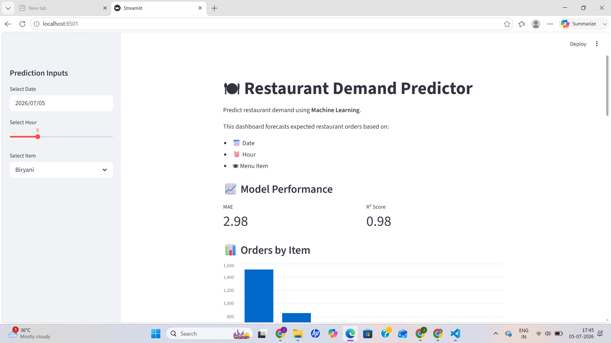
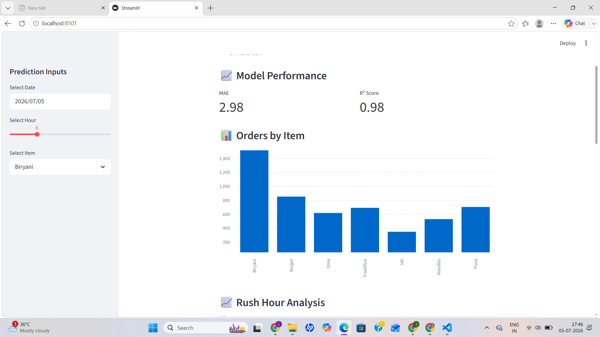
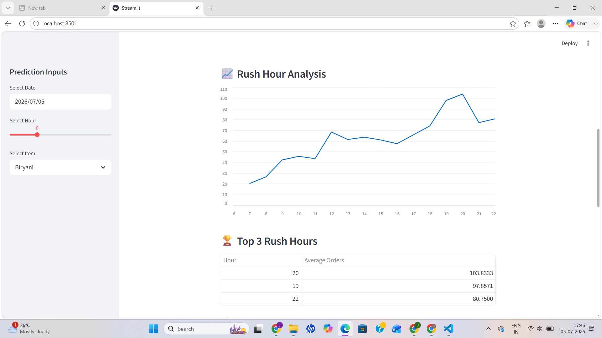
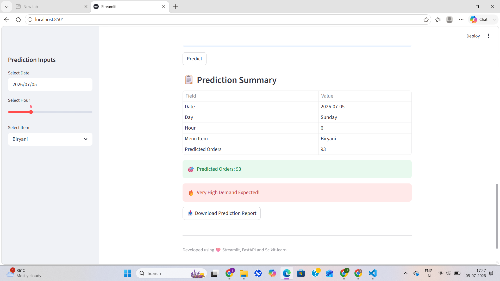

# 🍽 Restaurant Demand Predictor

A Machine Learning-powered web application that predicts restaurant food demand based on the selected date, time, and menu item. The project helps restaurants estimate customer demand, optimize inventory, and reduce food wastage.

---

## 📌 Features

- Predicts restaurant demand using Machine Learning
- Interactive Streamlit dashboard
- FastAPI backend for predictions
- Model performance metrics (MAE & R² Score)
- Orders by Item visualization
- Rush Hour Analysis
- Top 3 Rush Hours insights
- Dataset summary
- Prediction summary table
- Demand level alerts
- Download prediction report as CSV

---

## 🛠 Technologies Used

- Python
- Scikit-learn
- Pandas
- Streamlit
- FastAPI
- Uvicorn
- Pickle

---

## 📂 Project Structure

```
Restaurant-Demand-Predictor/
│
├── api/
│   └── main.py
│
├── dashboard/
│   └── app.py
│
├── data/
│   └── orders.csv
│
├── model/
│   ├── train.py
│   ├── preprocess.py
│   ├── model.pkl
│   └── metrics.json
│
├── requirements.txt
└── README.md
```

---

## 🚀 How to Run the Project

### Clone the repository

```bash
git clone <repository-url>
```

### Install dependencies

```bash
pip install -r requirements.txt
```

### Start the FastAPI server

```bash
uvicorn api.main:app --reload
```

### Start the Streamlit dashboard

```bash
streamlit run dashboard/app.py
```

---

## 📊 Dashboard Features

- 📈 Model Performance
- 📊 Orders by Item Chart
- 📈 Rush Hour Analysis
- 🏆 Top 3 Rush Hours
- 📋 Dataset Summary
- 📅 Selected Day Display
- 📋 Prediction Summary
- 📥 Download Prediction Report

---

## 📷 Screenshots

## 📷 Screenshots

### 🏠 Dashboard



---

### 📊 Orders by Item Chart



---

### 📈 Rush Hour Analysis



---

### 🎯 Prediction Result



## 📈 Machine Learning Model

- Algorithm: Linear Regression
- Train-Test Split: 80:20
- Evaluation Metrics:
  - Mean Absolute Error (MAE)
  - R² Score

---

## 🎯 Future Enhancements

- Deploy the application online
- Add more Machine Learning models
- Improve prediction accuracy
- User authentication
- Live restaurant order integration

---

## 👨‍💻 Developed By

**Jeevi**

Electrical and Electronics Engineering Student

Prince Shri Venkateshwara Padmavathy Engineering College, Chennai
